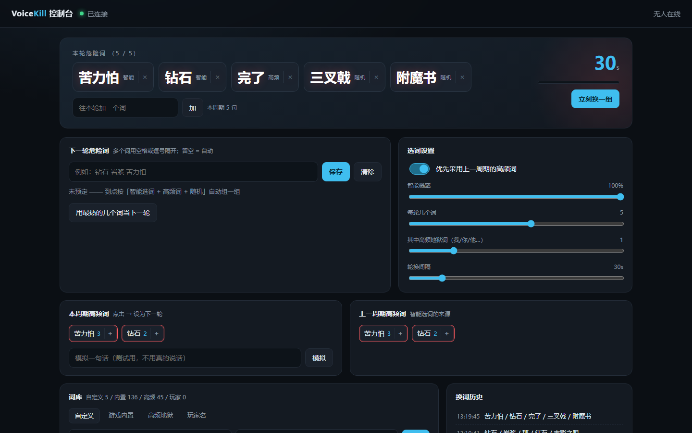

# VoiceKill

> 说到「危险词」就当场暴毙。危险词每 30 秒换一组，其中一部分甚至会「实时更新」。

Minecraft **1.21.11** / Fabric 模组。默认使用 Zipformer 中英双语离线模型，文本传输复用 [Shriek](https://modrinth.com/mod/shriek)，
说到本轮任意一个危险词就会被服务端 `kill()`。

当前工作区为 **1.0.15-dev.10 本地测试候选版**：使用 Silero 声学停顿决定双语 Zipformer 连续流的边界，默认停顿约 0.6 秒确认、连续讲话约 10 秒兜底；句末继续音频复核与离线标点恢复。
**换词不打断当前句子**：按讲话音频经历的轮次同时判定，前后组都命中时后组优先；换轮后才开始的新句子不沿用旧词，复核等待期间出现的新词也不追溯加入。见 [dev.10 验证](docs/DEV10_VALIDATION.md)。
完整初识不会仅因复核漏掉一个尾字母、同音换字或完整游戏词漏尾而被撤销；游戏专有词使用全量词库中的受约束读音纠错，详见 [dev.9 验证](docs/DEV9_VALIDATION.md)。
新增 **F7 统一设置、实时转写、粉红危险词标色、物品栏提示换行、可移动排行榜**。
本次完成自动回归与同组音频回放；界面沿用 dev.7 独立实例检查记录，真实玩家麦克风、口音及多人联机仍待验收。客户端与服务端建议使用同一版本。



## 声明
- 本 Mod 的功能设计，测试迭代由 [L\_FLA5H](https://github.com/L-FLA5H) 完成，代码开发由 AI 完成，

- 当前为开发候选版，语音仍可能误识别或漏判，真实设备与联机尚未验收，适合朋友间测试体验。

## 功能

- **每轮一组危险词**（默认 5 个），说出任意一个直接带带带
- **智能选词** —— 上一轮高频 ×3 + 整局累计 ×1，越常说越容易出
- **匹配容错** —— 长人名同音字（豆腐唐包包 → 豆腐汤宝宝）、已有别名/有限编辑距离、多候选回退，以及停顿拆词的有界拼接；单字只使用原始首候选
- **离线句末处理** —— SenseVoice INT8 结合整段音频复核中文口音字母拼读；CT Transformer 恢复标点，正文校验失败则保留原文
- **游戏专有词纠错** —— 内置 2270 个四字及以上 Minecraft 中文名称，完整音节同音纠错；经复核支持时允许整词内一次 n/l 或前后鼻音差异，竞争词与歧义结果保守处理
- **自然断句** —— 同一双语识别流跨越短暂换气和换轮，声学停顿确认后结算；持续讲话约 10 秒兜底，不随换词重置
- **跨轮句子判定** —— 同一句同时使用实际经历的前后词组，较新词组优先；新句子不沿用过期词，停止/重新开始及切服仍清除旧音频
- **自定义词与人名优先** —— 同等证据下完整词优先；精确命中先于模糊结果，不放宽既有匹配门槛
- **可调 HUD** —— 最多 20 个危险词自动换行/分页，物品栏上方提示换行，排行榜可按比例移动
- **实时转写** —— 左上危险词下显示临时/最终文本，精确出现的危险词粉红标注；临时文字只显示
- **F7 设置面板** —— 语音、设备、模型、字幕、布局和本地玩法参数；首页/暂停菜单也有入口
- **模型实时进度** —— F7 → 设备与模型 → 模型下载进度，显示各模型的百分比、已完成/总大小、当前文件、校验与失败状态
- **网页控制台** —— `http://127.0.0.1:38471/` 改词库、看统计、模拟输入
- **游戏内选麦克风** —— F8，选完立即生效，下次启动自动沿用
- **故障可见** —— F8 / 网页查看输入音量和连接错误，支持刷新、重新连接与停止录音
- **自定义死亡文本** —— 默认使用 20 条损友整活文案，可切换经典、装备与经验、声带背锅、正经胡说、自定义混搭，支持编辑、增删与预览，支持 `{player}` / `{word}`，用于正式死亡消息
- **安全预览** —— 网页「仅测匹配」显示命中证据，不处决玩家、不改词频

## 环境要求

| 东西 | 版本 |
| --- | --- |
| Minecraft Java 版 | **1.21.11** |
| Fabric Loader | **0.17.3+** |
| Java | **21** |

> 0.17.3 是 Fabric API 0.141.6 的硬性下限，不是本模组的要求。

## 安装

1. 把 **4 个模组**丢进 `mods`：`voicekill`、[Fabric API](https://modrinth.com/mod/fabric-api)、
   [Shriek](https://modrinth.com/mod/shriek)、[Architectury API](https://modrinth.com/mod/architectury-api)
2. 默认双语模型（约 60MB）首次启动在后台下载到 `<游戏目录>/voicekill/models/zipformer-bilingual-small-int8/`，不阻塞渲染线程。
   模型准备失败且允许回退时，使用 Vosk 中文模型（另约 42MB）；网页会显示实际引擎和回退原因。
3. 可选句末模型默认启用，后台另下载约 315MB（SenseVoice 约 240MB、标点约 76MB），缓存到同一 `voicekill/models/` 下；下载或加载期间继续基础识别。失败原因可在网页麦克风状态查看。
4. 自然断句另需约 0.64MB Silero 模型，目录为 `<游戏目录>/voicekill/models/silero-vad/silero_vad.onnx`。缺失时会提示并暂用 Zipformer 原流式端点。
5. 模型准备好后按下方命令开始游戏；首次准备进度和失败原因可在网页/F8 状态查看

**Shriek 是双端模组**，单人游戏也要装；联机时服务端和每个客户端都要装齐这 4 个。

dev.10 提供一个完整离线安装包，仍不带 Vosk；客户端与服务端都要更新 JAR，原四组模型可继续使用。不要用新模板覆盖自己的词库/设备配置，见 [安装教程](docs/INSTALL_DEV7.md) 和 [设置说明](docs/DEV7_SETTINGS.md)。

## 使用

```
/voicekill start     开始（别名 /vk start）
/voicekill stop      停止
/voicekill status    查看状态
```

模组默认**不启用**，不输入 start 不会判定、也不会统计词频。

Windows / macOS 均可按 **F8** 选择音频输入设备；也可在网页「麦克风状态」下拉选择后点击「连接并保存」。连接成功才保存配置，**下次启动会自动用同一个设备**。
设备较多时可翻页；麦克风断开后状态会显示失败，可重新选择设备。
输入音量长期为 0 时检查系统静音、输入设备和游戏/启动器的麦克风权限。
Mac 的权限还可能受启动器影响，见 [SVC 的 macOS 权限说明](https://modrepo.de/minecraft/voicechat/wiki/macos)。

单字危险词只接受最优候选，不再自动扩展中文单字谐音。长名字保留容错；英文/中英混合词按字母读音匹配，
不再受展示用别名数量上限限制。双语模型可直接输出英文，但昵称、字母读法仍可能听错，保留匹配容错。

句末复核不接收危险词列表。两次复核稳定一致的新结果可作为最终句；若复核只是把孤立缩写少识别一个尾字母、孤立单字换成同音字，或把完整游戏词漏掉一个尾音节，则保留完整初识及其显示。其他已接受的复核仍决定判定，避免“好吃的→英文”后继续按撤回中文处罚。新增字母命中仍限精确，单字不会仅因复核新增处罚。游戏名称的读音纠错独立于本轮危险词列表，需要完整音节及原始支持，不补全残词。标点仅用于展示。

这些约束降低新增误杀风险，但不能保证识别绝不出错；合成回放也不代表真人口音验收。详见 [dev.10 验证记录](docs/DEV10_VALIDATION.md)。没有把有争议的字母结果一律屏蔽。

F7 →「语音识别」开启「声学自然断句」，然后「保存并重连麦克风」。说一句完整的话优先使用 `speechMaxUtteranceSeconds: 10.0`、`speechEndpointSilenceSeconds: 0.6`。**已有配置里的 5.0 / 0.35 不会因更新 JAR 自动改变**，请在客户端配置中调整并重启。10 秒仍是防止持续讲话拖延的输入音频上限，另加声学检测、解码与网络耗时；较长停顿或超过上限仍会拆段。声学自然断句不等同于理解语法，逗号句号仅用于最终文字展示。

指定蓝牙耳机失败、系统默认麦克风成功时，可先在 Windows 中将常用麦克风设为默认，再按 F8 选择系统默认输入。dev.6 已统一输入设备枚举与打开时的筛选，避免选到同名输出设备，并支持 8kHz 及驱动报告的可转换原生格式；具体蓝牙设备仍需实机复测。

## 配置

`config/voicekill.json`，常改的几项：

| 字段 | 说明 |
| --- | --- |
| `deathMessageStyle` | 文案风格，默认 `friends`；其他为 `classic` / `loot` / `voice` / `deadpan` / `custom` |
| `customDeathMessages` / `deathMessages` | 自定义死亡消息开关（默认开）及自定义随机模板列表，由服务端管理 |
| `wordsPerRound` | 每轮几个危险词（1~20） |
| `highFreqPerRound` | 其中几个是「我/你/他」这类高频词 |
| `intervalSeconds` | 换词间隔（秒） |
| `smartPickChance` | 智能选词概率 0~100 |
| `audioDevice` | 录音设备名，留空 = 系统默认 |
| `voskModel` | Vosk 模型名 |
| `speechEngine` | `zipformer`（默认，中英双语）或 `vosk`（兼容模式） |
| `speechContextHints` | 本轮词表识别提示，默认 true；人名/自定义词优先，中文单字和短中文词不偏置 |
| `speechNaturalBoundary` | 默认 true，Silero 声学边界控制同一双语识别流；缺失模型时可见回退到原流式端点 |
| `speechEndpointSilenceSeconds` | 较长语音段的静音等待，默认 0.6 秒，允许句中短暂换气；确认停顿后提交 |
| `speechMaxUtteranceSeconds` | 自然模式从检测到讲话开始的连续讲话兜底预算，默认 10 秒，范围 2～15；空闲不计时，另加首词识别、解码、网络及游戏 tick 耗时 |
| `speechThreads` | 各离线模型 CPU 线程数，默认 1，范围 1～4 |
| `speechSentenceReview` | 句末音频复核，默认 true；关闭可回到基础流式识别 |
| `speechPunctuation` | 离线标点恢复，默认 true；仅用于展示 |
| `speechPostModelDir` | 句末模型缓存根目录，留空使用 `<游戏目录>/voicekill/models` |
| `allowVoskFallback` | 双语模型加载失败时是否允许回退，默认 true |
| `speechModelDir` | 双语模型自定义目录，空字符串使用默认缓存目录 |
| `autoModelDownload` | 自动下载所选模型；关闭后需要提前安装模型文件 |

F7 修改先进入草稿，点击「保存」才落盘，返回或 Esc 放弃未保存修改。字幕与布局立即生效；识别/模型参数需要「保存并重连麦克风」或重启。F8 设备切换独立保存，F7 草稿不会覆盖新选的设备。本地世界可改玩法参数，远程服务器词库和玩法由服主管理。

F7 →「游戏与词库」→「自定义死亡文本」可选风格并编辑本地世界的随机文案；联机由服主修改服务端配置。支持 `{player}` 玩家名、`{word}` 本次危险词。应用到草稿后还需点击父页面「保存」。处罚时继续显示原有的“玩家 / 危险词 / 识别原文”公告，随机死亡文案单独显示。

HUD 常用字段和默认值见 [设置说明](docs/DEV7_SETTINGS.md)。字面粉红标色不参与处罚，字幕里未标粉红也可能由服务端既有别名/长词容错命中。

## 构建

```bash
./gradlew build -x deployToGame
```

产物在 `build/libs/voicekill-<版本>.jar`。

Windows 使用 `./gradlew.bat build -x deployToGame`。当前仓库未启用自动部署；如果自行设置
`game_mods_dir`，普通 `build` 会执行部署，并先删除目标目录中的旧 VoiceKill JAR。

## 开发文档

- [dev.10 跨轮完整句与后组优先](docs/DEV10_VALIDATION.md)：不因换词重置音频、采样范围绑定词组、复核期间不追溯和原生回放
- [dev.9 初识保留与游戏词纠错](docs/DEV9_VALIDATION.md)：复核漏尾、同音字、受约束口音和原音频复测
- [dev.8 最终复核与高频词修复](docs/DEV8_VALIDATION.md)：截图误杀复现、词频重复计数、保留的漏判取舍
- [dev.7 自然断句与设置面板](docs/DEV7_SETTINGS.md)：升级路径、F7/F8、实时字幕、换行及排行榜位置
- [dev.7 同组回放与实机界面验证](docs/DEV7_VALIDATION.md)：保留漏判、误杀和延迟证据
- [dev.6 完整句设置与输入设备修复](docs/DEV6_VALIDATION.md)：10 秒 / 0.6 秒设置、同名输入输出回归与验收边界
- [dev.5 句末处理与复测](docs/DEV5_VALIDATION.md)：标点、音频复核、安全约束与当前验证结果
- [文档索引](docs/README.md)：用户说明、开发交接、接口资料的入口
- [项目结构与运行机制](docs/ARCHITECTURE.md)：按当前源码整理的模块、数据流、配置与验证边界
- [开发交接指南](docs/DEVELOPMENT.md)：开发环境、历史故障与调试方法
- [修复与验收说明](docs/FIXES_AND_VALIDATION.md)：回归覆盖、构建命令、实机验收项目
- [识别模型与回放测试](docs/ASR_MODELS.md)：双语模型、资源占用、回退与本机对比结果
- [识别优化与同组复测](docs/REPLAY_OPTIMIZATION.md)：原音频和匹配规则不变的前后对照
- [五个危险词回放报告](docs/NICKNAME_REPLAY.md)：合成语音下的识别原文、触发延迟及漏判/误触发

用户版与开发包已合并：保留仓库源码和构建配置，补入开发包的文档与工具。
原始开发 ZIP 和作者的部署配置保存在本地 `.local/archives/`，由 Git 忽略。

## 致谢

- [Shriek](https://modrinth.com/mod/shriek)（MIT）—— 语音识别与网络通道
- [sherpa-onnx](https://github.com/k2-fsa/sherpa-onnx)（Apache-2.0）—— Zipformer、SenseVoice 与离线标点推理
- [Vosk](https://alphacephei.com/vosk/)（Apache-2.0）—— 离线识别模型
- [Simple Voice Chat](https://modrinth.com/plugin/simple-voice-chat) —— 「自己接管录音才能热切换设备」的思路来自它

## 许可

[MIT](LICENSE) © 2026 L_FLA5H

## 判定与高频统计

最终选定句作为本段判定与统计输入；受约束的游戏名纠错同时用于最终字幕和词频，原始转写仍保留作校验依据和公告。复核漏尾等保留规则在句末选择阶段执行，避免显示与处罚各用一句；其他被撤回的原文不会继续独立处罚。原文全部获复核支持时，已有长名字分段可以继续衔接，高频/智能短词禁止跨段拼接。

高频与智能选词取消自动中文同音别名，显式手工别名仍有效；2～4 字统计重复计数已修复。固定“我/你/他”高频池按配额选取，与动态统计停用词规则分开。高频/智能来源不使用新增的游戏读音处罚。客户端和服务端都应更新到 dev.10；旧服务端不识别新增的轮次范围标记，混用版本可能丢失整段结果。
